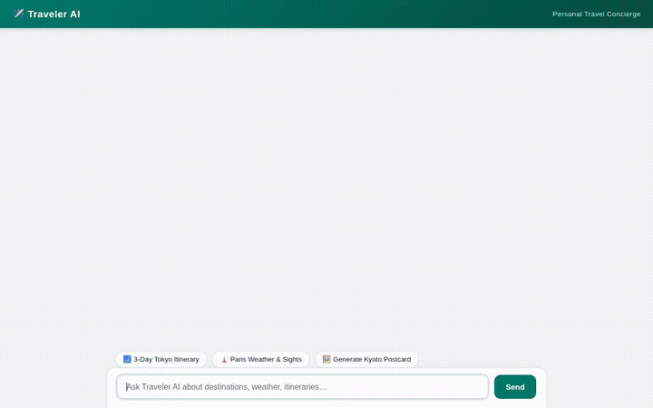

# Traveler AI ✈️

> Intelligent Personal Travel Concierge & Dynamic Itinerary Planner built with Google Cloud and Gemini.



---

## Overview

**Traveler AI** is a personal travel concierge agent designed to help travelers plan customized trips, discover attractions, check real-time weather and timezones, explore curated destinations, generate visual travel postcards, and perform calculations in a secure execution environment.

It is built with the **Google Agent Development Kit (ADK)** and deployed on **Google Cloud Agent Engine** (Agent Runtime) using the **Agent-to-Agent (A2A)** protocol.

---

## Wired Google Cloud Services & Core Capabilities

The following capabilities and Google Cloud services are directly wired and implemented in this repository:

### 1. Cross-Session Long-Term Memory (Vertex AI Memory Bank)
- **Integration:** Wired via ADK `PreloadMemoryTool` and `add_session_to_memory` (`after_agent_callback`).
- **Functionality:** Remembers stated user travel preferences, past visited places, and dietary/allergy restrictions (e.g. peanut or shellfish allergies) across distinct conversations and sessions.

### 2. Destination Catalog & Storage (Cloud Firestore)
- **Integration:** Google Cloud Firestore client (`google.cloud.firestore`).
- **Tools:**
  - `list_destinations(region, category)`: Fetches curated destination items from the Firestore collection.
  - `get_destination_details(destination_id)`: Retrieves complete destination profiles, best visiting times, and estimated costs.
  - `add_destination(...)`: Adds new attraction recommendations to the catalog.

### 3. Public Asset Hosting (Google Cloud Storage)
- **Integration:** Google Cloud Storage client (`google.cloud.storage`).
- **Functionality:** Stores generated postcard images and short videos in a public bucket, returning public HTTPS URLs for seamless web display.

### 4. Generative AI Media (Gemini Models on Vertex AI)
- **Postcard Image Generation:** Uses Google's `gemini-3.1-flash-lite-image` model (`generate_destination_image`) to create scenic travel images.
- **Destination Video Generation:** Uses Google's `gemini-omni-flash-preview` model (`generate_destination_video`) via the Vertex AI Interactions API to generate short video clips, saving artifacts via ADK `tool_context.save_artifact` and uploading to Cloud Storage.

### 5. Rich Adaptive UI Cards (A2UI)
- **Integration:** A2UI Schema v0.8 (`A2uiSchemaManager`, `BasicCatalog`) with custom `after_model_callback`.
- **Functionality:** Outputs structured JSON for Cards, Columns, Rows, Text (`h1`, `h2`, `body`), and public Images. The web chat interface natively parses and renders these components as responsive visual cards.

### 6. Secure Python Code Execution (Agent Engine Code Sandbox)
- **Integration:** ADK `AgentEngineSandboxCodeExecutor` pointing to a managed Agent Engine sandbox environment.
- **Functionality:** Runs Python code in a secure isolated sandbox for travel budget optimization, currency conversions, and travel data calculations.

### 7. Real-Time Travel Utility Tools
- **Live Weather (`get_weather`)**: Fetches live temperature, weather codes, humidity, and wind speed using Open-Meteo.
- **Current Time & Timezones (`get_current_time`)**: Checks current local times across international timezones.
- **Currency Conversion (`convert_currency`)**: Calculates live exchange rates for global currencies (USD, EUR, JPY, GBP, CAD, AUD, etc.).
- **Geocoding & Places (`geocode_address`, `find_nearby_places`)**: Integrates OpenStreetMap Nominatim and Overpass APIs for coordinate lookup and nearby place discovery.

---

## Planned Capabilities (Roadmap)

The following items from early project design concepts are **planned, not yet implemented**:
- **Estimated transit calculator / multi-city route optimization**: Planned, not yet implemented.
- **Recommended dining / hotel comparative table renderer**: Planned, not yet implemented.
- **Cloud Trace distributed tracing telemetry**: Planned, not yet implemented.

---

## Architecture

```
┌──────────────────────────────────────────────┐
│        Web Frontend (HTML / CSS / JS)        │
│  - Modern dialogue layout & avatar headers   │
│  - Clickable quick prompt chips              │
│  - Native A2UI v0.8 card renderer            │
└──────────────────────┬───────────────────────┘
                       │ HTTP /chat
┌──────────────────────▼───────────────────────┐
│         FastAPI Proxy Server                 │
│  - Google ADC token authentication           │
│  - A2A Client Factory (JSON-RPC / HTTP-JSON) │
└──────────────────────┬───────────────────────┘
                       │ A2A Protocol
┌──────────────────────▼───────────────────────┐
│     Agent Engine (Agent Runtime)             │
│  - ADK Root Agent (gemini-2.5-flash)         │
│  - Vertex AI Memory Bank                     │
│  - Agent Engine Sandbox Code Executor        │
│  - Firestore & Cloud Storage integrations    │
│  - Gemini Image & Omni Video generation      │
└──────────────────────────────────────────────┘
```

---

## Getting Started (Local Setup & Run)

### Prerequisites
- Python 3.10+
- Google Cloud SDK (`gcloud`) installed and logged in
- Active Google Cloud project with Application Default Credentials configured:
  ```bash
  gcloud auth application-default login
  gcloud config set project <YOUR_PROJECT_ID>
  ```

### 1. Install Dependencies
Set up a virtual environment and install project requirements:
```bash
python3 -m venv .venv
source .venv/bin/activate
pip install -r requirements.txt
pip install -r frontend/requirements.txt
```

### 2. Configure Environment Variables
Set the deployed Agent Engine resource name and agent directory:
```bash
export AGENT_ENGINE_RESOURCE_NAME="projects/<PROJECT_NUMBER>/locations/<REGION>/reasoningEngines/<RESOURCE_ID>"
export AGENT_DIRECTORY="app"
```

### 3. Run the Frontend & Proxy
Start the local web server:
```bash
cd frontend
python main.py
```
The server will start listening on port 8080. Open your browser and navigate to your local server address to interact with Traveler AI.
